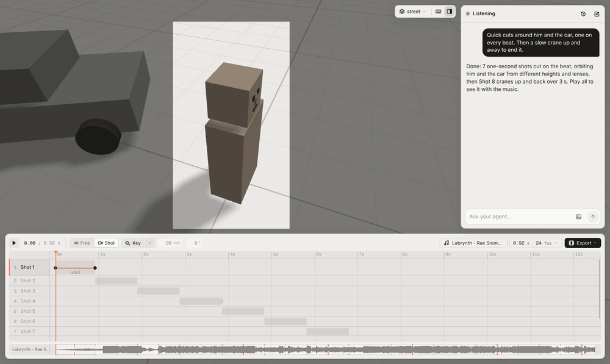
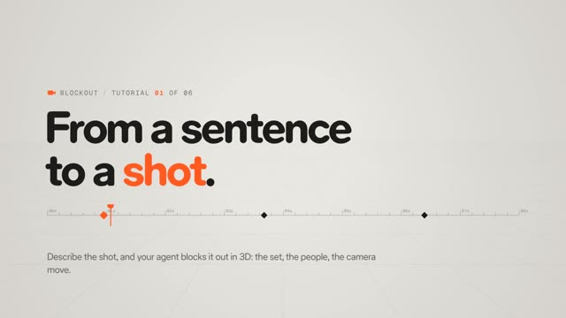
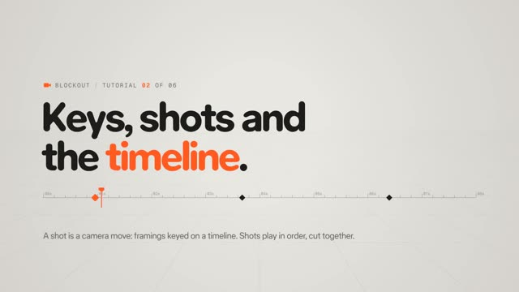
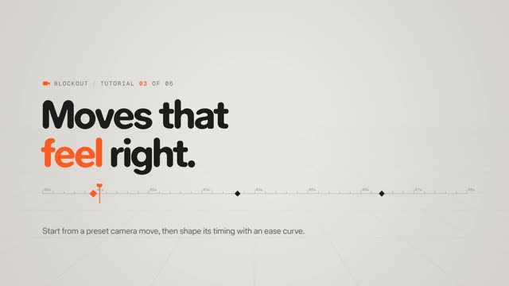
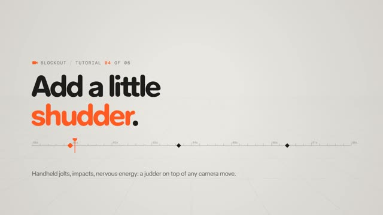
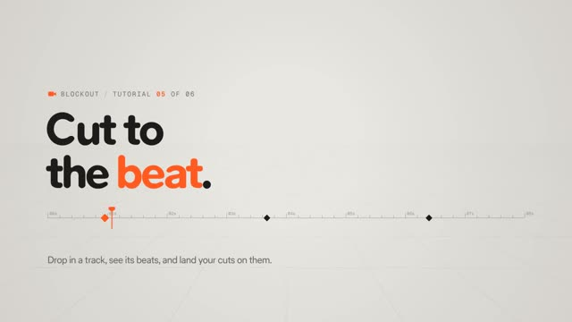
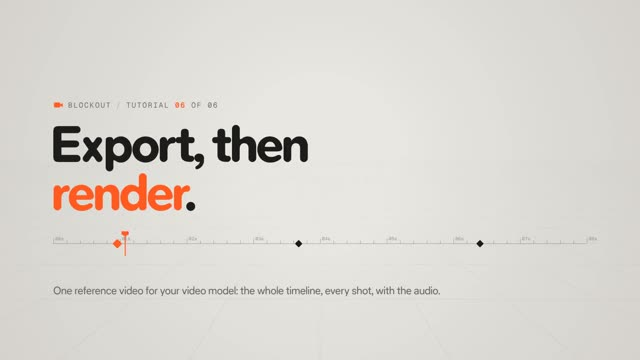

<h1 align="center">Blockout</h1>

<p align="center">
  <b>Block out 3D scenes and camera moves by chatting with your coding agent.</b><br>
  Then export the blockout as a reference video for a generative video model.
</p>

<p align="center">
  <a href="#quick-start">Quick start</a> ·
  <a href="#video-tutorials">Tutorials</a> ·
  <a href="docs/GUIDE.md">Guide</a> ·
  <a href="#for-agents-and-developers">For agents</a>
</p>

<p align="center">
  
</p>

Blockout is a minimal three.js canvas that Claude Code or Codex drives for you. Describe a shot in the chat
beside the canvas, and your agent builds the set out of simple shapes and people, keys the camera and cuts it
into shots while you watch. Adjust anything by hand, then export one video of the whole timeline.

- **Describe it.** "Quick cuts around him and the car, one on every beat, then a slow crane up and away."
- **Shape it.** Key framings, pick preset moves, draw ease curves, cut between shots, lay music under it.
- **Export it.** One MP4 of every shot in order, ready for Seedance, Veo, Kling or any reference-to-video model.
  Optionally, your agent can render it through ComfyUI for you.

## Video tutorials

Six short videos, under a minute each.

<table>
  <tr>
    <td width="33%" valign="top"><a href="docs/tutorials/01-getting-started.mp4"></a><br><sub><b>1</b> · Getting started</sub></td>
    <td width="33%" valign="top"><a href="docs/tutorials/02-shots-and-timeline.mp4"></a><br><sub><b>2</b> · Shots and the timeline</sub></td>
    <td width="33%" valign="top"><a href="docs/tutorials/03-camera-moves-and-eases.mp4"></a><br><sub><b>3</b> · Camera moves and eases</sub></td>
  </tr>
  <tr>
    <td width="33%" valign="top"><a href="docs/tutorials/04-shudder.mp4"></a><br><sub><b>4</b> · Shudder</sub></td>
    <td width="33%" valign="top"><a href="docs/tutorials/05-audio-and-beats.mp4"></a><br><sub><b>5</b> · Audio and beats</sub></td>
    <td width="33%" valign="top"><a href="docs/tutorials/06-export-and-render-with-comfy.mp4"></a><br><sub><b>6</b> · Export and render with Comfy</sub></td>
  </tr>
</table>

## Quick start

You need Node 20+ and Chrome, Edge or Safari 17+. In any Claude Code session, install the plugin once:

```
/plugin marketplace add shrimbly/blockout
/plugin install blockout@blockout
```

Then, in any folder:

```
/blockout:start a lighthouse on a cliff, slow orbit
```

Claude starts the canvas, opens it in your browser and starts listening to it. Keep talking in the terminal or
in the canvas chat: it is the same conversation. Your scenes, saves and exports live in `~/Blockout/scenes/`.

<details>
<summary><b>Updating the plugin</b></summary>

<br>

Claude Code doesn't auto-update plugins from third-party marketplaces unless you turn it on: run `/plugin`,
open **Marketplaces**, select `blockout` and choose **Enable auto-update**. Or update by hand with
`/plugin marketplace update blockout`. Every commit on `main` is an update, and the next `/blockout:start`
restarts the canvas on the new copy.

Installed it before as `blockout-agent`? Run `/plugin uninstall blockout-agent@blockout-agent` and
`/plugin marketplace remove blockout-agent`, then the two install commands above.

</details>

<details>
<summary><b>Without the plugin: Codex, or working on Blockout itself</b></summary>

<br>

```bash
git clone https://github.com/shrimbly/blockout && cd blockout
npm install
node bin/canvas.mjs up      # starts the server and opens http://127.0.0.1:5317
```

Then open `claude` or `codex` in this folder and say what to block out. Claude Code loads the skill and hooks
from `.claude/`; Codex reads `AGENTS.md` and `.agents/skills/`. Say "listen to the canvas" to prompt from the
canvas chat. A checkout keeps its scenes in its own `scenes/` folder.

To use the skill from any folder without the plugin: `node bin/sync-skills.mjs --global`.

</details>

## Using the canvas

The basics, at a glance. The [guide](docs/GUIDE.md) has every control.

| | |
|---|---|
| **Chat** | `/` focuses the chat. Your selection, the playhead and the camera go along with each message, so "make this taller" just works. |
| **Look around** | Drag to orbit, right-drag to pan, scroll to zoom, `W` `A` `S` `D` to fly. Click to aim the camera. |
| **Key the camera** | `C` looks through the shot camera. Frame it, press `K` to key it at the playhead. The caret on **Key** has preset moves. |
| **Shots** | One set, several cameras. **+ New shot** or `Shift N` adds one; **Play all** plays through the cuts. |
| **Export** | **Export full video** renders every shot, with the audio, into one MP4 in `scenes/exports/`. |
| **Undo** | `⌘Z` undoes anything, including your agent's changes. |

## Render with ComfyUI

Optional. Choose **Render with Comfy** in the Export menu, or ask "render this with Seedance". Your agent fits
one of your ComfyUI workflows to the timeline, writes a timed prompt from the camera moves, and shows you the
prompt and the cost before anything runs. It works with Comfy Cloud or your own ComfyUI. See the
[guide](docs/GUIDE.md#render-with-comfyui) and the [`blockout-render` skill](skills/blockout-render/SKILL.md).

## For agents and developers

- [AGENTS.md](AGENTS.md): project instructions (Codex, and Claude through CLAUDE.md)
- [skills/blockout/SKILL.md](skills/blockout/SKILL.md): the skill, with the workflow, conventions and camera craft
- [skills/blockout/references/api.md](skills/blockout/references/api.md): ops, CLI and HTTP reference
- [docs/GUIDE.md](docs/GUIDE.md#how-it-works): how it works, and environment variables
- [docs/DESIGN.md](docs/DESIGN.md): design system for new controls

Your agent drives the canvas with the `canvas` command:

```bash
node bin/canvas.mjs add box --name tower --size 2,8,2 --pos -3,0,-2
node bin/canvas.mjs add person --pos 0,0,3
node bin/canvas.mjs key --t 0 --pos 6,1.6,10 --target 0,1.5,0 --lens 28
node bin/canvas.mjs key --t 5 --pos 1,1.5,5 --target 0,1.6,0 --lens 50 --ease slowOut
node bin/canvas.mjs storyboard     # contact sheet PNG of the move
node bin/canvas.mjs export         # mp4 path
node bin/canvas.mjs help           # every command
```

Tests: `npm test` for the core, `npm run e2e` for the browser (needs Playwright).

## License

[MIT](LICENSE)
